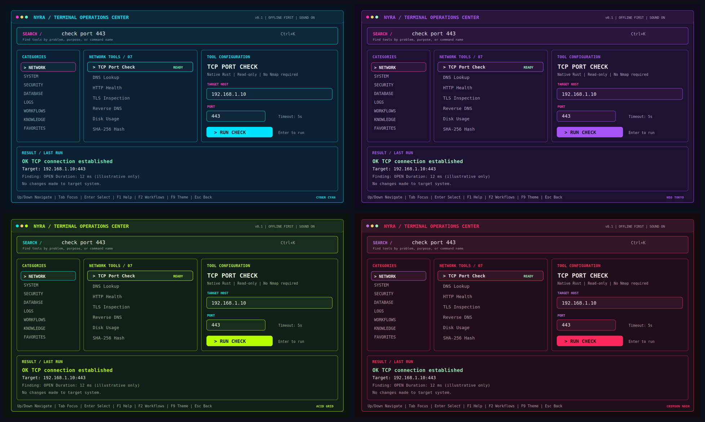

# NYRA

**NYRA — Your System. Your Tools. Anywhere.**

> Planning repository for a portable, offline-first System Administrator toolkit built with Rust. Inspired by cyberpunk terminal apps (including Capri); not a copy or fork.

**Status:** Phase 1 development; 0/10 release phase gates are closed. The worktree contains the shared registry, the first 12 diagnostics, the guided TUI, appearance and discovery features, offline command references, Web Diagnostics, and sanitized JSON/HTML/CSV reports for Web Diagnostics. Custom typed TOML workflows can now be validated with `nyra workflow validate` and run sequentially with `nyra workflow run-file` through the shared diagnostic executor. Workflow results contain safe step summaries; arbitrary custom-workflow report export is not available.

**Verification on 2026-11-23:** Kali WSL passed `cargo fmt --all -- --check`, `cargo clippy --all-targets --locked -- -D warnings`, and `cargo test --locked --all-targets` (124 unit, 33 CLI). Windows x64 GNU format, check, and Clippy pass. Its full test suite remains blocked during linking by AWS-LC/MinGW's undefined `nanosleep64` symbol from `pthread_time.h`.

Hosted CI, clean-host checks, TUI PTY testing, platform smoke tests, the TUI workflow builder, generic custom-workflow reports, TUI report export, selection effects, optional sound, and release gates remain open. Kali WSL is not a clean Ubuntu host. Registry metadata is not evidence of supported-platform status; see the roadmap for the current gates.

## Product in one paragraph

NYRA is a portable IT operations companion used from a USB drive or downloaded as a platform-specific release. It combines a fast interactive terminal UI (TUI), a script-friendly direct CLI, diagnostic workflows, and an offline command knowledge base. Users search *what they want to inspect* (including curated English aliases) without needing to remember a command. Built-in Rust diagnostics are preferred; optional external or remote adapters are capability-gated. No AI account or network backend is required for core use.

## The three modes

- **Interactive:** `nyra` — browse/search tools, edit validated inputs, run and inspect results in a Ratatui UI.
- **Direct CLI:** `nyra net tcp <host> <port>` — predictable output, exit codes and JSON for automation.
- **Workflow:** `nyra workflow run web-unreachable --target https://example.com` — DNS, TCP, TLS and HTTP in one run.

Web Diagnostics and the custom-workflow CLI are implemented through the shared executor. Windows x64 GNU format, check, and Clippy pass locally, but the full Windows test suite is blocked by the AWS-LC/MinGW `nanosleep64` linker issue. TUI PTY, clean-host, platform smoke, and release checks remain pending. The TUI workflow builder and other workflow templates are planned. The earlier working title was **PocketOps**. The executable name is `nyra` (`nyra.exe` on Windows); this naming does not imply a verified platform release.

## Development CLI

With a stable Rust toolchain and a platform linker installed, run:

```sh
cargo build --locked
cargo run --locked -- --help
cargo run --locked -- tools list
cargo run --locked -- net tcp 127.0.0.1 443 --timeout 5 --output json
cargo run --locked -- net dns example.com --record-types A,AAAA
cargo run --locked -- web check https://example.com
cargo run --locked -- workflow run web-unreachable --target https://example.com --output json
cargo run --locked -- workflow run web-unreachable --target https://example.com --report-json ./web-report.json
cargo run --locked -- workflow run web-unreachable --target https://example.com --report-html ./web-report.html
cargo run --locked -- workflow run web-unreachable --target https://example.com --report-csv ./web-report.csv
cargo run --locked -- workflow validate examples/workflows/local-system-health.toml
cargo run --locked -- workflow run-file examples/workflows/local-system-health.toml --output text
cargo run --locked -- workflow run-file examples/workflows/local-system-health.toml --output json
cargo run --locked -- tls inspect example.com
cargo run --locked -- sys disk
cargo run --locked -- theme validate examples/custom-theme.toml
cargo run --locked -- theme import examples/custom-theme.toml
cargo run --locked -- theme export ./theme-backup.toml
cargo run --locked -- knowledge list
cargo run --locked -- knowledge search check port
cargo run --locked -- knowledge show linux.find-large-files
```

Knowledge cards are offline references only. NYRA displays their command text but never executes it.

Network checks accept one explicitly supplied hostname, address, or URL and use bounded timeouts. DNS uses the system resolver configuration; HTTP follows no redirects and omits URL query values from results; TLS inspection records normal system validation while sending no application data; ping requires the OS `ping` utility and may be affected by ICMP filtering. Text output is the default. Direct-tool `--output json` emits its `RunResult`; `workflow run-file --output json` emits schema-version-1 workflow status and step summaries without input values or raw tool output. For Web Diagnostics, choose one of `--report-json`, `--report-html`, or `--report-csv` with an explicit `<PATH>` to write a separate sanitized report. The path is relative to the current working directory, its parent must exist, and an existing file is never replaced. No report is written without an option. Reports redact the full target and omit observer identity and raw result data; each is limited to 64 KiB. `--output json` is separate from an exported report file. Usage errors go to stderr.

Optional diagnostic logs are disabled by default. Add `--log-level error|warn|info|debug` to a command to write logs to stderr; `debug` includes run start and completion events. Logs use an allowlist of tool ID, execution status, finding category, duration, and static error category. They omit target hosts, URL paths and queries, file paths, and raw error messages, so JSON remains parseable on stdout.

| Exit | Meaning |
|---|---|
| 0 | Positive diagnostic finding, such as an accepted connection or healthy HTTP status |
| 1 | Check completed with a negative finding, such as refusal, no DNS answer, or non-2xx HTTP status |
| 2 | Invalid command or input |
| 3 | Run could not complete because of a system or environment error |
| 4 | Run budget expired before a finding could be reported |
| 130 | Check cancelled |

## Read this first

Start with the [end-to-end design](docs/end-to-end-design.md) for user journeys, component boundaries, and the order of implementation.

1. [Product requirements](docs/product-requirements.md)
2. [Decision log](docs/decisions.md) — what has already been agreed
3. [Master roadmap and backlog](docs/roadmap.md)
4. [Architecture and contracts](docs/architecture.md)
5. [Interactive TUI and UX](docs/tui-ux.md)
6. [Tool catalog and discovery](docs/tool-catalog.md)
7. [Workflow and incident diagnostics](docs/workflows.md)
8. [Themes, animation and sound](docs/experience.md)
9. [Portability and security](docs/portability-security.md)
10. [Verification and release criteria](docs/testing-release.md)
11. [AI agent skills](docs/agent-skills.md)
12. [Design references + four editable TUI mockups](docs/design-references.md)
13. [Codex Cloud handoff](docs/CODEX_START_HERE.md)
14. [First Codex task: NYRA-001](docs/CODEX_TASK_001.md)
15. [Agent working agreement](AGENTS.md)
16. [Example configuration](examples/config.toml)
17. [Example workflow definition](examples/web-unreachable.toml)

## Baseline

- Rust stable + Clap + Ratatui/Crossterm + Tokio; Serde/TOML for config; native Rust tooling first.
- Four configurable cyberpunk themes: Cyber Cyan, Neo Tokyo, Acid Grid, Crimson Noir.
- Optional sound/animation with graceful fallback.
- Read-only by default; never silently change production systems or save plaintext credentials.
- Per-platform artifacts, not one binary for every OS.
- Windows and Linux first; macOS/ARM64 after platform validation, Solaris via SSH; older Windows is not promised.
- Separate roadmap stages from **implemented/tested** status. No feature is complete merely because it appears in a spec.

## License

NYRA is distributed under the [MIT License](LICENSE).

## Design previews — all four configurable themes



| Theme | Preview (PNG) | Editable concept (SVG) |
|---|---|---|
| Cyber Cyan | [View PNG](assets/mockups/nyra-cyber-cyan.png) | [Edit SVG](assets/mockups/nyra-cyber-cyan.svg) |
| Neo Tokyo | [View PNG](assets/mockups/nyra-neo-tokyo.png) | [Edit SVG](assets/mockups/nyra-neo-tokyo.svg) |
| Acid Grid | [View PNG](assets/mockups/nyra-acid-grid.png) | [Edit SVG](assets/mockups/nyra-acid-grid.svg) |
| Crimson Noir | [View PNG](assets/mockups/nyra-crimson-noir.png) | [Edit SVG](assets/mockups/nyra-crimson-noir.svg) |

These are **SVG-derived PNG concept previews** of a planned terminal UI, not captures of running code or the original chat-generated raster designs. See [image provenance](assets/mockups/ORIGINALS_NOTICE.md).

## Initial instruction for Codex Cloud

Open [docs/CODEX_START_HERE.md](docs/CODEX_START_HERE.md), then read [AGENTS.md](AGENTS.md). Start with **Phase 0 validation and Phase 1 Rust skeleton**, preserving the contracts and creating tests before claiming a feature works.

## Credits & boundaries

Capri is an aesthetic reference only. Do not copy proprietary artwork, sound effects, branding, or code without checking licenses. All referenced skills/libraries require independent verification and security review before installation.

**Repository:** https://github.com/somkid-s5/NYRA
