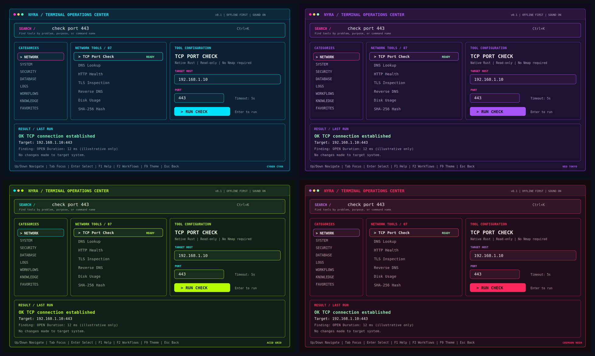

# NYRA — UI mockup gallery

These four editable SVG visuals and their generated PNG versions depict a real-terminal-feasible Ratatui layout in four themes. The PNGs are built from the SVGs by [GitHub Actions](../../.github/workflows/render-ui-previews.yml).

| Theme | Editable design | PNG preview |
|---|---|---|
| Cyber Cyan | [SVG](nyra-cyber-cyan.svg) | [PNG](nyra-cyber-cyan.png) |
| Neo Tokyo | [SVG](nyra-neo-tokyo.svg) | [PNG](nyra-neo-tokyo.png) |
| Acid Grid | [SVG](nyra-acid-grid.svg) | [PNG](nyra-acid-grid.png) |
| Crimson Noir | [SVG](nyra-crimson-noir.svg) | [PNG](nyra-crimson-noir.png) |

**Important:** These images are design prototypes, **not actual program screenshots**. Source SVGs were created as editable replacements for earlier original chat-rendered PNGs. See [original image note](ORIGINALS_NOTICE.md) for why the four exact chat-generated PNG files are not in GitHub.

Read [TUI UX](../../docs/tui-ux.md) and [Theme spec](../../docs/experience.md) for the implementation contract.
