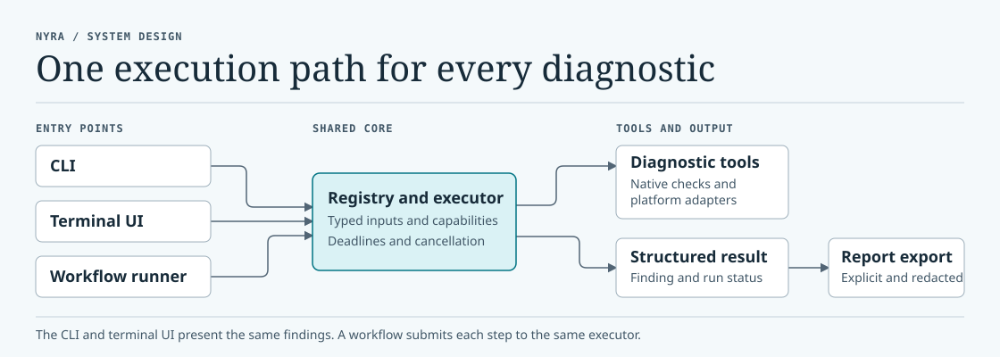

# NYRA — Technical Architecture and Contracts

## Component architecture

See the [editable source](../assets/diagrams/nyra-architecture.html) and the [end-to-end design](end-to-end-design.md) for the user journeys and release gates.

## Architectural style
A **modular monolith**: one platform-specific Rust binary and shared core execution engine. TUI, CLI and workflows are interfaces over the same Tool Registry/Executor. No backend service or mandatory AI network calls.

## Modules and responsibilities
| Module | Responsibilities | Boundary |
|---|---|---|
| cli | Clap args, help, output/exit mapping | No tool-specific network implementation |
| tui | Ratatui rendering, state, key events, forms, progress | Never blocks on I/O |
| core/registry | Tool IDs, category, metadata, platform/risk/deps | Single discovery source |
| core/executor | Typed inputs, validation, context, cancellation, timeouts | One execution path |
| core/result | Data, findings, errors, timestamps, stable JSON schemas | UI-agnostic |
| tools/* | Native diagnostics grouped by domain | No direct UI concerns |
| adapters/* | OS commands, third-party binaries and remote transport | Permission/dependency checks |
| search | Fuzzy + curated English keywords | No LLM required |
| workflows | Step scheduling/conditions/shared parameters | Calls registry tools |
| knowledge | Offline docs, command templates, risk metadata | No arbitrary shell by default |
| reports | HTML/JSON/CSV rendering, opt-in output persistence | Sanitization and redaction |
| config/storage | TOML settings, themes, favorites, profiles, history | Portable vs user paths |
| audio/effects | Non-blocking best-effort UX cues | Never required for core tools |

## Proposed dependency candidates (validate versions before use)
Rust stable; Clap; Ratatui + Crossterm; Tokio; Serde + TOML; Tracing; Nucleo (fuzzy); Reqwest + Rustls; DNS library such as Hickory; Sysinfo. Add libraries only on proven need. Audio platform integration must preserve portability.

## Key types (design, not implemented)
**ToolMetadata**: id, version, display_name, description, keywords, category, platform list, execution_backend, capability_requirements, risk_level, input_schema, output_schema.
**InputSchema**: named typed fields (host, IP, port, URL, path, duration, enum), required/defaults/validation; never bare shell interpolation.
**ExecutionContext**: cancellation token, timeout, verbosity, target permissions, capability snapshot, privacy policy.
**ExecutionResult**: run_id, tool_id, tool_version, target, started_at, duration_ms, execution_status, diagnostic_findings, data, error, warnings, platform.
**CapabilityReport**: supported/unavailable/requires-setup + reason and remediation steps.

## Crucial status distinction
- *Execution success*: tool ran correctly and reported a finding (which may indicate a closed port).
- *Diagnostic finding*: OPEN/CLOSED/REFUSED/TIMED_OUT/UNKNOWN as appropriate.
- *Execution failure*: invalid input, unsupported OS, missing deps, internal exception, cancellation, auth error.

The CLI uses 0 for a positive finding, 1 for a completed negative finding, 2 for invalid input, 3 for execution or environment failures, 4 when the run reaches its deadline before reporting a finding, and 130 for cancellation. A timed-out TCP connection attempt is a finding and uses exit code 1.

## CLI contract (implemented in the worktree; verification pending)
~~~sh
nyra
nyra --help
nyra tools list
nyra net tcp 192.168.1.10 443 --timeout 5 --output json
nyra net dns example.com --record-types A,AAAA
nyra net reverse-dns 192.0.2.10
nyra net ping example.com --count 4
nyra net interfaces
nyra web check https://example.com
nyra tls inspect example.com
nyra sys info
nyra sys disk
nyra file sha256 ./artifact.bin
nyra workflow run web-unreachable --target https://example.com
~~~
Use stable parameter names, machine-readable JSON, true/false/unknown where semantically needed; avoid silently changing schema versions. Render stdout for results, stderr for diagnostics/progress/errors; no ANSI on JSON.

## TCP result example
~~~json
{
  "schema_version": 1,
  "tool_id": "network.tcp",
  "target": "192.168.1.10:443",
  "execution_status": "completed",
  "finding": "open",
  "duration_ms": 12,
  "error": null
}
~~~
Real durations and connectivity must be measured; example data is fictional.

## Concurrency and lifecycle
- Main loop owns TUI AppState; tool tasks execute asynchronously and return typed messages.
- Always bound number of running tasks, port ranges, scan targets and timeouts.
- Signal cancellation to operations; clean up terminal modes on panic/interrupt.
- Stream large log results rather than reading entire files into memory.
- Use shared executor for workflows and interactive tool invocation.

## Data paths
- Packaged/readonly assets: bundled or shipped with release for themes, knowledge and optional sounds.
- Portable workspace: enabled with portable.flag, stores config/ themes/ profiles/ recipes/ data/ reports/ beside application root when writable.
- Standard mode: OS user config/data directories.
- If USB is readonly: run capabilities that need no persistence and report save limitations.
- Credentials never stored as plaintext in portable config. History/report persistence opt-in/redacted.

## Suggested source layout (subject to scaffold)
src/main.rs, src/cli/, src/tui/{screens,widgets,effects}, src/core/{registry,executor,result,workflow,safety}, src/tools/{network,system,security,database,logs}, src/adapters/{windows,linux,ssh,external}, src/{search,config,knowledge,reports,audio,storage}; plus workflows/, recipes/, knowledge/, assets/, docs/, tests/ and .github/workflows/.

## Decisions requiring spikes/tests
- Concrete Windows and Linux binary target triples; Windows Server compatibility.
- Native TLS certificate inspection semantics (chain validity vs expiry).
- Raw ICMP privileges and platform-specific ping behavior.
- DNS resolver strategy (system resolver vs explicit query).
- Portable cross-platform audio backend availability.
- Windows remote auth and TLS policy.
- Custom tool pack sandboxing and third-party command allowlisting.
