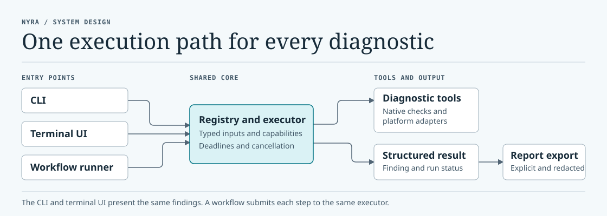

# NYRA End-to-End Design

NYRA is an English-language, offline-first toolkit for a system administrator working at a Windows machine or in a Linux terminal. The first usable release lets the operator find and run the Core 12 diagnostics from the CLI and TUI, run Web Diagnostics from one URL, and troubleshoot without installing Rust on the machine being used.

This design starts from the verified Windows GNU TCP CLI slice. The milestones below describe planned work. See the [roadmap](roadmap.md) for implementation and verification status.

[Editable diagram source](../assets/diagrams/nyra-architecture.html)

## What the operator can do

| Situation | User journey | Evidence presented |
|---|---|---|
| Check an application port | Open NYRA, search “check port,” enter a host and port, run and inspect the result | Connection accepted, refused, timed out, unreachable, or inconclusive from this machine |
| Diagnose and save a website check | Run `nyra workflow run web-unreachable --target <url> --report-json <path>` (or `--report-html` / `--report-csv`) | DNS, TCP, TLS when applicable, HTTP, skipped steps, next checks, and a sanitized report with a redacted target |
| Investigate disk space | Search “disk space,” open Disk Usage, select a volume or inspect the list | Available and total space per volume, plus unavailable values and permission errors |
| Automate a diagnostic | Run a tool by its CLI command with `--output json` | One versioned result on stdout and a documented exit code |
| Work away from a development machine | Launch the Windows binary from USB, or open the Linux binary in an existing SSH session | The machine running NYRA is the source of observations. Portable settings are read from the workspace |

## Product boundaries and components

- **CLI:** Clap validates command syntax and maps shared results to text, JSON, and exit codes. Running `nyra` with an interactive terminal opens the TUI. A noninteractive terminal receives usage guidance. Explicit subcommands never need a TUI.
- **TUI:** Ratatui and Crossterm render screen state. Search and forms use registry metadata. Workers return progress and results as messages so the terminal event loop stays responsive.
- **Workflow runner:** Builds a validated sequence from a bundled definition, maps shared input to tool inputs, and sends each step to the executor. Runtime conditions refer to typed statuses or findings.
- **Registry and executor:** A single Cargo package owns stable tool IDs, English metadata, aliases, fields, capabilities and read-only risk ratings. The executor validates typed input, checks capability, enforces deadlines, propagates cancellation, and returns the result. Keep typed dispatch while it remains easy to extend.
- **Tools and adapters:** Tool implementations own the checks. Adapters isolate platform APIs, permitted OS programs, and later authenticated remote sessions. Record capability limitations before execution and return actionable errors if prerequisites change.
- **Persistence and reports:** Settings, saved-tool preferences, diagnostic history and reports have separate storage policies. Saved tools persist only tool IDs in `[discovery].favorite_tools` and `[discovery].recent_tools`, cap Recent at 10 IDs, and do not store targets or input values. Ctrl+R disables recent tracking, clears the existing IDs and persists `[discovery].record_recent = false`; enabling it again starts fresh. The initial CLI report uses a dedicated allowlist and always redacts the target; generic and TUI exports still need their own tested sanitization.

## Catalog and interaction

The [Core 12 catalog](tool-catalog.md#core-12-initial-build) covers TCP, DNS, Reverse DNS, HTTP, TLS, local network details, Ping, system information, CPU, memory, disks and SHA-256. Deliver DNS, TLS and HTTP immediately after the TCP foundation so Web Diagnostics can be tested early. Build disk usage next to exercise the local-system result shape before filling in the remaining catalog.

Search ranks exact tool names and curated task aliases first, then token matches, then fuzzy matches with stable ties by tool ID. Suggested fixtures include “check port,” “resolve hostname,” “certificate expiry,” “disk space,” and “calculate file hash.” English is the app language. Paths and terminal text still require Unicode support.

| Screen | Primary action | Navigation and recovery |
|---|---|---|
| Home and tool list | Choose a tool, search, or open a workflow | Arrow keys browse, Enter opens, Ctrl+K opens search, F1 shows scoped help |
| Search | Type a task or tool name | Up/Down selects, Enter opens, Esc returns without running anything |
| Form | Review where the check runs, fill fields, activate Run | Tab and Shift+Tab move focus. Inline validation preserves input and focuses the first invalid field |
| Running | Inspect current phase or step, cancel | Esc requests cancellation and keeps completed observations. Ctrl+C cancels and exits with terminal cleanup |
| Result | Read finding, timing, scope and useful next check | Back returns to the filled form. Explicit copy/export actions show what will be shared |
| Workflows and settings | F2 opens workflows. F9 opens appearance | F5 opens Favorites/Recent; Tab switches lists. F6 opens Command Knowledge; Ctrl+K opens global tool search. Ctrl+F toggles the selected tool or card favorite. Ctrl+R disables Recent and clears stored IDs; enabling it again starts fresh. Text fields own ordinary typing keys. At 80×24, use one active panel with the same actions |

All four themes ship as editable palette data. Widgets read semantic tokens for text, selection and status. Focus and status also use labels. Validate custom TOML before applying it and keep the last valid palette if loading fails. Optional motion and sound can be disabled and stay quiet in CLI and SSH/headless use.

## Execution and output contract

Keep the TCP schema v1 fields and documented exit behavior. Before release, define a common result envelope for the other tools and fixtures for every stable field. Use an optional typed data object for tool-specific measurements such as bytes, certificate dates, and resolver answers. Use explicit units, UTC timestamps where present, and a tool identifier on each result. Breaking field or semantic changes require a new schema version.

| Exit code | Meaning |
|---|---|
| 0 | Completed with the requested positive finding or measurement |
| 1 | Completed with a negative or inconclusive finding |
| 2 | Input or invocation rejected before execution |
| 3 | Run failed because of a capability, environment, or internal error |
| 4 | Run budget expired before a finding could be reported |
| 130 | Operator cancelled |

Transport refusal and a timed-out TCP attempt are observations. Scope findings to the attempted endpoint and machine. Keep invalid inputs off stdout. Emit one JSON result for a started operation, including failure or cancellation. Progress and human-readable errors go to stderr. Align command help, README examples and integration tests with the same contract.

## Web Diagnostics from input to report

1. Validate a single HTTP or HTTPS URL. Reject embedded credentials. Show the destination host and effective port before the TUI run.
2. For hostnames, resolve addresses with the system resolver used by the connectivity check. An IP literal skips DNS. A named query for specific DNS record types is a separate use case with its own result.
3. Run TCP against a bounded set of resolved addresses and retain the successful address. Pass that address and the original hostname to TLS and HTTP so every later observation concerns the same endpoint.
4. For HTTPS, validate the certificate chain and hostname and capture relevant certificate information. For plain HTTP, mark TLS skipped. If HTTPS verification fails, report the TLS finding and skip the HTTP step.
5. Make a bounded HTTP request to the same origin. Record status, elapsed time and safe headers. Record redirects as an observation and let the operator decide whether to check the new URL.
6. Summarize the first failing step and the evidence available. DNS failure skips dependent steps. Cancellation preserves completed steps and records unfinished ones. The CLI can write a sanitized JSON, HTML, or CSV report to an explicit path; generic tool CLI reports and TUI export remain planned.

Example: DNS answers, TCP connects, and the certificate is expired. The result identifies TLS as the first failed step, shows the confirmed expiry, marks HTTP skipped, and suggests checking the certificate served by that endpoint. If HTTP returns 503 after successful TLS, report the observed 503 and suggest checking the application or upstream service.

## Data, permissions, and portability

Start with local read-only checks and single-target network checks. Bound input sizes, address attempts, response data and file processing. Cancellation propagates to active operations and child processes. A timed-out or cancelled OS DNS call may finish in the background, so the executor also bounds outstanding resolver calls. Optional programs receive typed argument arrays and show setup instructions when absent.

Use OS user directories in standard mode. Locate the portable workspace from the executable and its `portable.flag`, including the documented layout with binaries one level below the marker. A read-only portable workspace runs diagnostics without writing to the host profile. Write validated settings using atomic replacement where supported. History starts disabled. The current Web Diagnostics JSON report requires an explicit destination, redacts all target identifiers, omits raw result data, and refuses overwrite. Credentials remain in the platform credential store or authentication agent. No target-inclusion option exists for this report; any future target disclosure requires a separate explicit design.

Target separate Windows and Linux x64 archives first. Validate Windows 11 and representative Ubuntu environments using clean machines and non-admin accounts. Use both writable and read-only media for the Windows USB trial. Exercise Linux through an existing SSH connection at 80×24. A Linux binary launched in SSH is running locally on that host. NYRA initiating SSH is an advanced feature with independent host verification, authentication and audit gates.

## Build order and exit gates

| Order | Work | Gate |
|---|---|---|
| 1 | Finish the shared TCP foundation and document the CLI contract | Local Windows tests already pass. Verify the registry and schema fixtures, minimal redacted diagnostics, and CI on Windows and Ubuntu |
| 2 | Implement DNS, TLS, HTTP and first bundled Web Diagnostics | Local endpoints now cover DNS, open/refused TCP, valid and invalid TLS, HTTP errors, and skipped steps; trusted HTTPS is verified on Kali WSL only, with clean-host coverage still open |
| 3 | Add disk usage and remaining Core 12 tools | Each tool has help, typed inputs, supported capabilities, bounded behavior, and deterministic contract tests |
| 4 | Deliver keyboard TUI, global tool search, saved tools, Command Knowledge, four themes, accessible settings and optional effects | CLI/TUI results agree; saved-tool preferences contain only tool IDs, with Recent capped at 10. TestBackend and terminal tests cover 80×24, focus, resize, cancellation and restoration |
| 5 | Package the first usable release with the workflow and portable settings | Complete the three operator journeys above on clean Windows/Linux. Verify Windows USB, Linux SSH, archive contents, checksums and review |
| 6 | Expand knowledge cards, favorites, report formats and the typed workflow builder | Typed workflow definitions can be validated and run as sequential TOML files through the shared executor; the bundled local system health example is exercised. Web Diagnostics CLI JSON/HTML/CSV reports are implemented. The TUI builder, generic custom-workflow report export, TUI export, and clean-host matrix remain open |
| 7 | Add advanced read-only checks as capabilities are verified | SSH and Windows remote verify identity. Database diagnostics distinguish transport access from protocol or database health |
| 8 | Release v1.0 with evidence-based incident mode | Scenario tests, supported-platform smoke tests, accessibility and performance evidence, security review, reproducible archives and release documentation pass |

The rows group work by user outcome. Existing phase and version labels remain in the [roadmap](roadmap.md). The first usable release depends on early pieces of several phases. Review each change independently using code, tests and an actual user flow.
